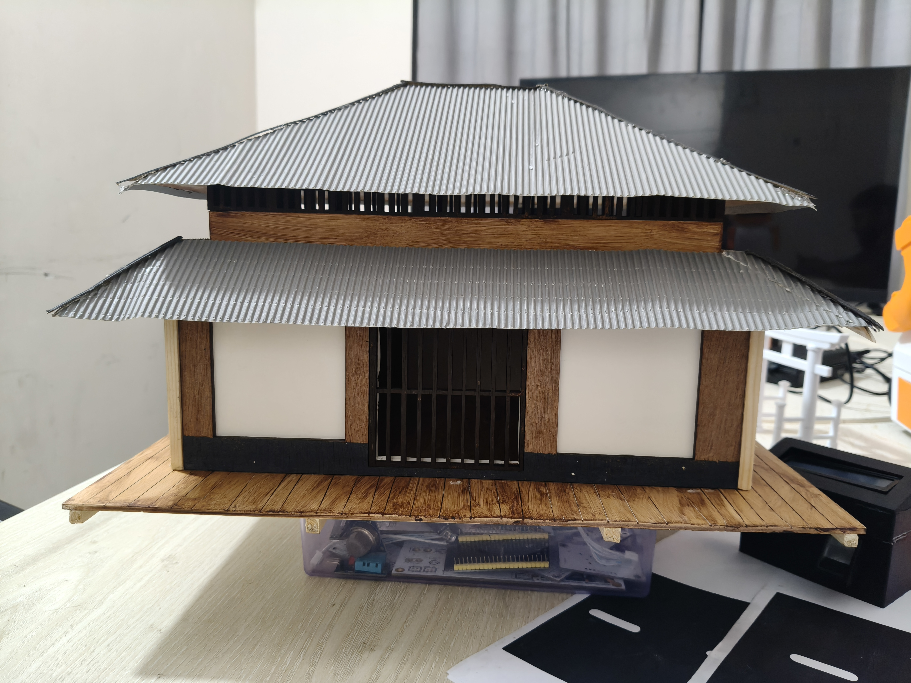
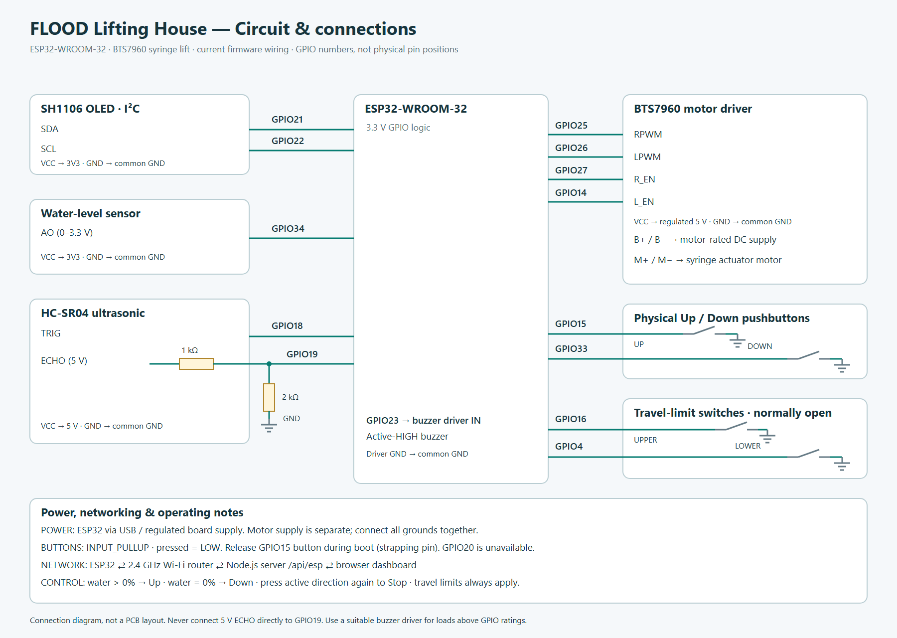
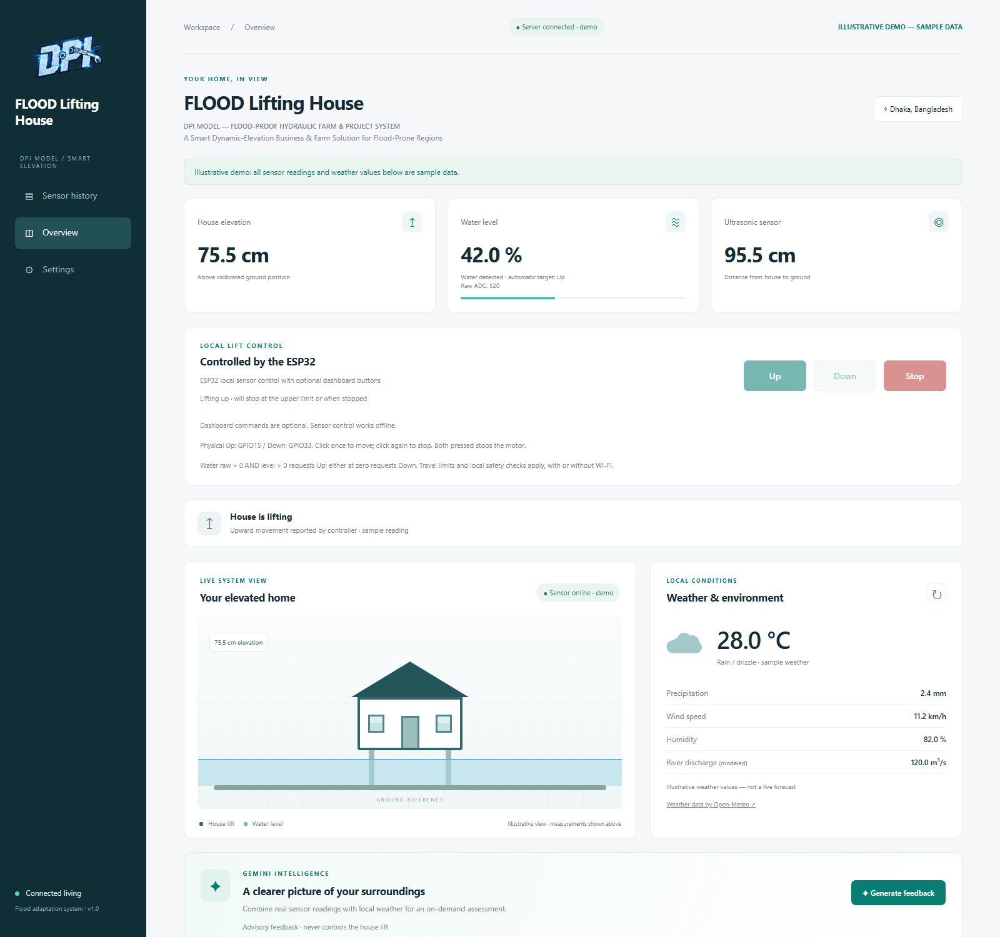

# Flood Lifting House

**A flood-responsive house prototype for a more sustainable city.** Built by **Tahasin Al Mahabi and Fiham** for the **World Robot Games 2026 in Japan**, Sustainable City section.



Flooding can make homes and farms vulnerable to rising water. This project demonstrates a possible response: a model house mounted on a motor-driven lifting mechanism. An ESP32 reads a water sensor and controls the lift locally; a computer dashboard displays sensor readings, movement, weather, and history. It is a prototype for learning and demonstration, not a certified flood-protection system.

[Full project report (PDF)](docs/DPI_Model_Complete_Report_Business.pdf) ? [3D-printable STL files](docs/models/) ? [Build photos](docs/Media/build/) ? [Team photos](docs/Media/team/) ? [Project video](docs/Media/demo/VID20261114015252.mp4) ? [Hardware guide](docs/hardware.md)

## How it works

1. A water sensor provides a reading to the ESP32. In automatic mode, the controller uses wet and dry thresholds to decide whether to raise or lower the house.
2. The ESP32 drives a motor through a BTS7960 motor driver. The motor operates the mechanical lift; upper and lower limit switches stop travel in the corresponding direction.
3. Physical buttons and the ESP32's local web page provide manual controls. The controller can operate locally even when the main dashboard or network is unavailable.
4. An ultrasonic sensor measures distance to a fixed ground reference for the dashboard's height estimate. It is for monitoring and does not stop the motor.
5. When connected to the local network, the ESP32 sends readings to the Node.js server. The browser dashboard displays the readings and stores history; internet access adds weather and optional Gemini feedback.

`Water sensor ? ESP32 ? motor driver ? lift ? house`  
`ESP32 ? local network ? server and database ? dashboard`

## Project team

Tahasin Al Mahabi and Fiham built the project for the World Robot Games 2026 in Japan, in the Sustainable City section.


[Another team photo](docs/Media/team/team-event-2.jpg)

## Proud moment — World Robot Games 2026

Our ambassador **Fiham Ahmed** and the **Dynamic Project Innovators (DPI)** team represented Bangladesh at the International Round of the **World Robot Games (WRG) 2026** in Japan. Competing against participants from 22 countries, they secured **4th place worldwide** in two separate international categories and earned **two Copper Medals**.

### The project: DPI Model — a Flood-Proof Hydraulic Farm & Project System

Bangladesh is one of the most flood-prone countries in the world, and floods cause heavy losses to homes, crops, livestock, and small businesses every year. The team proposed an additional layer of flood resilience: when water levels rise, a hydraulic scissor-lift raises a lightweight structure above the flood level.

**Key components:**

- Water-level sensing
- Automatic control
- Mechanical safety locks
- Solar backup

It is designed to complement, not replace, embankments, drainage, and early warning systems, and it would go through full-scale engineering validation before real-world deployment.

Congratulations to project lead **Tahasin Al Mahabi**, **Fiham Ahmed**, and every member of the DPI team. Taking a real local problem to an international stage and returning with results is a strong example of what young Bangladeshi innovators can do.

At ZAN Tech, we believe that with the right opportunities and guidance, students can lead globally. This achievement is one more proof of that.

Best wishes to the team for every step ahead.


## Build process

The photographs document the prototype's construction. The report and STL files provide further project material; the repository does not specify exact print quantities, dimensions, materials, or a complete mechanical bill of materials, so check the models and adapt the assembly to your own components.

| Stage                       | What to do                                                                                                                                     | Project photos                                                                                                                                                                                                                                                                            |
| --------------------------- | ---------------------------------------------------------------------------------------------------------------------------------------------- | ----------------------------------------------------------------------------------------------------------------------------------------------------------------------------------------------------------------------------------------------------------------------------------------- |
| Plan and prepare            | Review the report, sketch the layout, and prepare a stable base and house model.                                                               | [Design sketch](docs/Media/build/IMG20261114035815.jpg), [house model](docs/Media/build/IMG20261112194640.jpg)                                                                                                                                                                            |
| Print and assemble the lift | Inspect the STL files in a slicer, choose suitable print settings, and assemble and check the moving scissor parts.                            | [Scissor assembly 1](docs/Media/build/IMG20261114003246.jpg), [assembly 2](docs/Media/build/IMG20261114003248.jpg), [assembly 3](docs/Media/build/IMG20261114003258.jpg)                                                                                                                  |
| Install the drive           | Fit the motor and printed pushing mechanism to the base; check that the mechanism moves freely.                                                | [Motor assembly 1](docs/Media/build/IMG20261114003418.jpg), [assembly 2](docs/Media/build/IMG20261114003431.jpg), [detail](docs/Media/build/IMG20261114003442.jpg)                                                                                                                        |
| Assemble the house          | Mount and align the house on the lifting structure and secure the assembly to its base.                                                        | [Preparation 1](docs/Media/build/IMG20261114003222.jpg), [preparation 2](docs/Media/build/IMG20261114003228.jpg), [mounting 1](docs/Media/build/IMG20261114003233.jpg), [mounting 2](docs/Media/build/IMG20261114003236.jpg)                                                              |
| Wire and test               | Connect the ESP32, sensors, motor driver, buttons, and limit switches using the wiring guide. Check direction and limits before adding a load. | [Wiring](docs/Media/build/IMG20261114003451.jpg), [base and electronics](docs/Media/build/IMG20261114035822.jpg), [testing 1](docs/Media/build/IMG20261114015229.jpg), [testing 2](docs/Media/build/IMG20261114015233.jpg), [assembled prototype](docs/Media/build/IMG20261114015237.jpg) |

[Watch the project video](docs/Media/demo/VID20261114015252.mp4) ? [Browse all build photos](docs/Media/build/)

### Parts and tools

The controller setup uses an ESP32-WROOM-32, water sensor, BTS7960 motor driver, DC motor and suitable motor power supply, two direction buttons, two travel limit switches, an SH1106 OLED, and an optional HC-SR04 ultrasonic sensor. You will also need wiring, a common ground, a 3.3 V-safe divider for the HC-SR04 ECHO signal, a computer, and a means to print and assemble the mechanical parts. See the [hardware guide](docs/hardware.md) for GPIO connections and control behavior.

### 3D-printable parts

All supplied STL files are in [docs/models](docs/models/). Open them in your slicer to inspect size, orientation, supports, and fit before printing. Multiple nut versions are included; select the version that fits your assembly.

| Part                  | Files                                                                                                                                                                                                                                                                            |
| --------------------- | -------------------------------------------------------------------------------------------------------------------------------------------------------------------------------------------------------------------------------------------------------------------------------- |
| Base and structure    | [Base v3](docs/models/Base%20v3.stl), [Scissor Base](docs/models/Scissor%20Base.stl), [Blade](docs/models/Blade.stl)                                                                                                                                                             |
| Connectors and guides | [Corner Connector](docs/models/Corner%20Connector.stl), [L connector](docs/models/L%20connector.stl), [Slider](docs/models/Slider.stl), [Slider Support](docs/models/Slider%20Support.stl), [T-Bottom](docs/models/T-Bottom.stl), [T-top](docs/models/T-top.stl)                 |
| Drive and fasteners   | [Pusher Base](docs/models/Pusher%20Base.stl), [Pushing Mechanism V2](docs/models/Pushing%20Mechanism%20V2.stl), [Pully](docs/models/Pully.stl), [Bolt](docs/models/Bolt.stl), [Nut](docs/models/Nut.stl), [Nut v1](docs/models/Nut%20v1.stl), [Nut v2](docs/models/Nut%20v2.stl) |

### Firmware and first physical test

1. Wire the components using the [pin table and circuit diagram](docs/hardware.md#wiring). Provide an independent physical motor power cutoff and keep the lift unloaded for initial checks.
2. Install the ESP32 board package, U8g2, and ArduinoJson 7 in Arduino IDE. Open [the firmware sketch](firmware/esp32_controller/esp32_controller.ino).
3. Set your own 2.4 GHz Wi-Fi credentials and the computer's LAN address in [config.h](firmware/esp32_controller/config.h). Set your own access-point password and calibrate the water sensor and thresholds for your hardware. Do not publish real credentials.
4. Select the board and port, upload the sketch, and open Serial Monitor at 115200 baud. Connect to the configured ESP32 access point and open the address shown in Serial Monitor.
5. Verify motor direction, both limit switches, STOP, manual controls, and wet/dry behavior with no load. Adjust the mechanism and calibration before testing the complete model. The detailed [hardware guide](docs/hardware.md) explains control priority.
6. Set up the computer dashboard below, then confirm telemetry arrives over the same local network.

## Circuit diagram and dashboard preview

The connection diagram follows the current ESP32-WROOM-32 firmware, including Up on GPIO32, Down on GPIO33, both travel limits and the ultrasonic ECHO voltage divider. GPIO20 is unavailable on this module. See the [hardware guide](docs/hardware.md) before wiring.



[Download circuit PNG](docs/images/circuit-diagram.png) · [Scalable SVG](docs/images/circuit-diagram.svg)

The dashboard preview uses the actual application layout with **illustrative sample sensor readings and weather**, not live device measurements.



[Download dashboard PNG](docs/images/dashboard-demo.png) · [Open standalone demo](docs/images/dashboard-demo.html)

## Set up on another PC: step by step

### Step 1 — Install Node.js

1. Download Node.js from [nodejs.org](https://nodejs.org/en/download). Install a supported version **22.13.0 or newer**, including npm.
2. Close and reopen your terminal after installation.
3. Check both commands:

```powershell
node --version
npm.cmd --version
```

On macOS/Linux, use `npm --version`. Node 22.13+ is required for the built-in SQLite history database. Node 22 may print an experimental SQLite warning; this does not stop the application. See the [Node SQLite documentation](https://nodejs.org/download/release/v22.13.1/docs/api/sqlite.html).

### Step 2 — Transfer the project

Copy or ZIP the project folder to the new PC, for example `C:\Projects\flood-lifting-house`.

Include:

- `src/`, `public/`, `docs/`, and `tests/`.
- `package.json` and **`package-lock.json`**.
- `README.md`, `.env.example`, `.gitignore`, `.editorconfig`, `.prettierrc.json`, and `.prettierignore`.

Do not copy `node_modules/`; the new PC installs its own dependencies. Create a new `.env` in Step 4 rather than sharing a folder containing API keys. A fresh setup does not require `data/`; the app creates it automatically.

To keep your existing location settings and history, follow **Back up or move existing data** below before starting the new installation.

### Step 3 — Open the project and install dependencies

Open PowerShell in the project folder, or run the following with your actual path:

```powershell
cd "C:\Projects\flood-lifting-house"
npm.cmd ci
```

Wait for installation to finish. Internet access is required to download packages. Use `npm.cmd` on Windows if PowerShell blocks `npm.ps1`.

On macOS/Linux:

```sh
cd /your/path/flood-lifting-house
npm ci
```

### Step 4 — Create your environment file

On a new Windows installation:

```powershell
Copy-Item .env.example .env
```

On macOS/Linux:

```sh
cp .env.example .env
```

Skip this copy if `.env` already exists and you want to keep it. Open `.env` in an editor:

```dotenv
PORT=3000
GEMINI_API_KEY=your_gemini_api_key_here
GEMINI_MODEL=gemini-2.5-flash
```

Get a key from [Google AI Studio](https://aistudio.google.com/apikey). You can leave `GEMINI_API_KEY` empty and add it later in Settings. A dashboard-entered key lasts until the server restarts; a `.env` key loads on every startup. Never commit `.env` or publish a key.

Weather and online city search use Open-Meteo and do not need a Gemini key. Review Open-Meteo's terms for commercial use. Gemini needs an accessible model and sufficient quota.

### Step 5 — Start the server

```powershell
npm.cmd start
```

On macOS/Linux use `npm start`.

Open **http://localhost:3000** in a browser on that PC. Keep the terminal running. Ctrl+C stops the server. To run the project again later, open the project folder and run the same start command; you do not need to reinstall dependencies each time.

If you change `PORT` in `.env`, restart the server and use the new port in the browser and controller URL. Restart after any `.env` change.

### Step 6 — Set location and Gemini connection

1. Open **Settings**.
2. Select the country. Its bundled city directory loads automatically.
3. Pick a city. Type to filter the directory, or use **Search online** for a missing place.
4. Enter a Gemini key if you did not configure one in `.env`.
5. Click **Save configuration**.
6. Return to **Overview** and check the local weather.

Settings contains location and Gemini connection only. Motor control runs entirely on the ESP32. Water thresholds and network settings are configured in `firmware/esp32_controller/config.h`; the server baseline only affects displayed elevation.

### Step 7 — Connect the ESP32/controller to the new PC

ESP32-WROOM-32 firmware is included in `firmware/esp32_controller/`. Follow the [wiring, flashing and calibration guide](docs/hardware.md), then use the [API reference](docs/api.md) for protocol details.

1. Connect the PC and controller to the same trusted local network.
2. On Windows, run `ipconfig` and find the active Wi-Fi/Ethernet adapter's IPv4 address, for example `192.168.1.25`.
3. Configure the controller's server URL as `http://192.168.1.25:3000/api/esp`, replacing the example IP and port.
4. If Windows Firewall prompts, allow Node.js on the private network. If the controller cannot connect, check the PC's firewall settings for that port.
5. Send HTTP POST JSON every 2–5 seconds with `Content-Type: application/json`:

```json
{
  "level": 42,
  "distanceCm": 95.5,
  "motorActive": false
}
```

Use the new PC's LAN address on the controller, **not `localhost`**. Another device's `localhost` refers to that device. Update the controller URL if the PC's network address changes. The dashboard is also available from another device at `http://PC_LAN_IP:3000` while the server runs.

| Field         | Meaning                                                              |
| ------------- | -------------------------------------------------------------------- |
| `level`       | Water sensor percentage, a number from 0–100.                        |
| `distanceCm`  | Ultrasonic distance, 0–1000 cm. Optional or null on an invalid echo. |
| `motorActive` | Boolean representing the motor's actual state.                       |

Mount the ultrasonic sensor on the house facing down toward a fixed ground reference. House elevation is `max(0, distanceCm - baselineCm)`. With a 20 cm baseline and 95.5 cm distance, height is 75.5 cm. A sensor pointing at changing water measures water clearance rather than ground-relative elevation.

The server acknowledges telemetry with `{ "ok": true, "controlMode": "local" }`. Optional dashboard requests are returned as liftCommand with a unique commandId; local automatic control does not depend on receiving them. Wi-Fi, HTTP failure, server shutdown and browser closure do not interrupt local lift operation.

### Step 8 — Verify the installation

Check that sensor values change in Overview and that the lifting indicator follows the actual motor state. Without hardware, you can inject **one example reading** from the PC:

```powershell
Invoke-RestMethod -Uri http://localhost:3000/api/esp -Method Post -ContentType 'application/json' -Body '{"level":42,"distanceCm":95.5,"motorActive":false}'
```

This creates a real saved log containing example values. Do not confuse it with a physical measurement. If no further reading arrives within 30 seconds, live sensor status becomes stale.

Open **Sensor history**, click **Today** or **All dates**, and confirm that a row appears. Restart the server and reopen history to confirm the log remains saved. Gemini feedback requires a key, fresh sensor data, and available current weather.

## Local lift control and dashboard monitoring

The firmware follows the supplied working controller: GPIO32/33 physical buttons, wet/dry ADC hysteresis at 500/300, active-low travel limits and full-duty analogWrite motor output. Forward means Up; reverse means Down. Physical buttons apply while held. The ESP32-hosted page provides Forward, Reverse, AUTO and persistent STOP commands.

The ESP32 runs a local access point and optionally joins the configured router to upload telemetry. The main dashboard monitors actual direction and animates the house while moving. Ultrasonic readings are for monitoring; they do not block motion in this controller. See the [hardware guide](docs/hardware.md) for wiring, control priority and connection instructions.

## Sensor and weather history

Every valid, successfully accepted `POST /api/esp` is saved to **`data/history.sqlite`** before the server acknowledges it. A controller retry can create another reading; this protocol has no device-provided deduplication ID. Invalid inputs are rejected and do not create rows. A storage failure returns HTTP 503 rather than silently acknowledging an unsaved log.

Each record contains:

- Server receipt date/time, water percentage, ultrasonic distance, calculated house height, and actual motor status.
- The city, country, coordinates, and baseline in effect at receipt.
- The latest weather snapshot for those coordinates: temperature, precipitation, wind, humidity, weather code, and modeled river discharge when available.
- Weather fetch timestamp, provider observation time when available, snapshot age, and availability/staleness status.

Weather is fetched at startup, every 10 minutes, and on manual refresh. Logging uses the latest matching snapshot already available, so a sensor update does not wait for a weather API request. A reading received before the first successful weather fetch, or during an outage/location change, may have unavailable weather. A snapshot fetched more than 20 minutes earlier is marked stale. Snapshot age measures time since fetch; the weather provider's observation time is stored separately. River discharge is modeled, not a local flood-depth measurement.

Historical rows keep their original data when settings change. Logging begins after installing this feature; earlier sensor readings cannot be recovered automatically.

### View readings by date and time

1. Open **Sensor history** in the sidebar.
2. Use **Today**, or choose **From date & time** and **To date & time**.
3. Click **Apply / Refresh**.
4. Browse **Older** and **Newer** pages of 50 rows, or use **All dates** to remove date limits.
5. Refresh to include new readings. Scroll the table sideways on smaller screens to see all weather columns.

Timestamps are stored in UTC. Filters and displayed receipt/fetch times use the browser's timezone, shown above the table. The To filter includes the full selected second. Weather observation time is shown in the location's timezone. Set the new PC's date, time, and timezone correctly before logging.

Logs survive server restarts. There is no automatic log deletion; monitor disk usage and back up the data folder. SQLite is embedded in Node.js, so no separate database server is needed.

## Back up or move existing data

1. Stop the server with Ctrl+C and wait for it to exit before copying the database.
2. Copy the entire **`data/`** folder to your backup or the same project root on the new PC. It contains `config.json`, `history.sqlite`, and potentially SQLite `-wal`/`-shm` companion files. Keep the whole set together.
3. Keep a separate secure backup of `.env` if you need the same API key; otherwise create a new one using Step 4.
4. On the new PC, run `npm.cmd ci`, configure `.env`, then `npm.cmd start`.
5. Confirm the location settings and Sensor history, and update the controller's LAN server address.

A Git clone does not include `data/` or `.env` because both are ignored. Copying only the source code starts a new history database. Do not replace the data folder of a running server or merge database files manually.

## Troubleshooting

| Problem                      | Check                                                                                      |
| ---------------------------- | ------------------------------------------------------------------------------------------ |
| `node` or `npm` not found    | Install Node.js and reopen the terminal.                                                   |
| `npm.ps1` blocked            | Use `npm.cmd` on Windows.                                                                  |
| `node:sqlite` unavailable    | Upgrade to Node.js 22.13.0 or newer.                                                       |
| Port already in use          | Stop the other instance or change `PORT`; update browser/controller URLs.                  |
| No sensor data               | Check controller URL, Wi-Fi, firewall, and JSON field types.                               |
| Sensor stale / motor unknown | No fresh reading within 30 seconds, or server connection lost.                             |
| No history rows              | Check Today/All dates, PC clock/timezone, and whether valid telemetry is arriving.         |
| HTTP 503 on telemetry        | Check disk space and permission to write the project's `data/` folder.                     |
| Weather unavailable          | Check internet access and refresh. Sensor records still save with missing weather labeled. |
| Wrong house height           | Check downward sensor mounting and the baseline in the saved configuration.                |
| Gemini failed                | Check key, model access, quota, internet, and fresh sensor/weather data.                   |

This prototype has no authentication. Use it on a trusted local network; add authentication, HTTPS, and request limits before public hosting. Use independent engineered safety controls for a physical lift.

## Project structure

```text
src/
  server.js             Environment loading, startup, shutdown
  app.js                Application assembly
  config/               Defaults, paths, timing constants
  domain/               Input validation
  routes/               HTTP API, including history queries
  realtime/             Socket.IO handlers
  services/             Configuration, telemetry, history, locations, weather, Gemini
public/
  index.html
  assets/images/        Project team logo
  css/                  Styles
  js/features/          Overview, settings, locations, history, weather, feedback
  js/lib/               Shared browser helpers
  js/app.js             Browser entry point
tests/                  Automated tests using isolated temporary data
docs/                   Architecture, API, hardware notes
data/                   Local settings and SQLite history; ignored by Git
.env.example            Configuration template
package.json            Commands and dependencies
package-lock.json       Reproducible dependency versions
```

## Development commands

```powershell
npm.cmd run dev
npm.cmd test
npm.cmd run format:check
npm.cmd run format
```

Development mode restarts the backend after source edits; refresh the browser after frontend edits. Tests use isolated temporary files, a test document for browser behavior, and fake weather/AI responses. They do not require sensors or a real API key and do not replace visual browser testing. A runtime-only installation can use `npm.cmd ci --omit=dev`; tests and formatting tools are intended for the full installation.

See [architecture](docs/architecture.md), [API reference](docs/api.md), and [hardware integration](docs/hardware.md).

Provider references: [Open-Meteo weather](https://open-meteo.com/en/docs), [geocoding](https://open-meteo.com/en/docs/geocoding-api), [flood model](https://open-meteo.com/en/docs/flood-api), [Gemini JavaScript SDK](https://googleapis.github.io/js-genai/), and [country-state-city directory](https://github.com/harpreetkhalsagtbit/country-state-city). The directory is not a guarantee of every settlement.

## Firmware scheduling

Local control, OLED, local web requests and ultrasonic monitoring run in the Arduino loop, matching the supplied working sketch. A separate telemetry task on core 0 uploads queue snapshots without waiting in the control loop. See the [hardware guide](docs/hardware.md) for timing and behavior.
